<div align="center">


# MySemester

**Courses, grades, GPA and Quercus deadlines, kept together in one calm dashboard.**


<br>
<br>


<sub>[Live site](https://mysemester.org) &nbsp;·&nbsp; [The promo](#the-promo) &nbsp;·&nbsp; [What's new](#whats-new-in-20) &nbsp;·&nbsp; [Quercus deadlines](#quercus-deadlines) &nbsp;·&nbsp; [Where your data lives](#where-your-data-lives) &nbsp;·&nbsp; [Get started](#get-started)</sub>

</div>

<br>

MySemester is a small web app for keeping track of a semester. Add your courses and their weighted assessments, and it works out each course's average, your letter grades and your GPA on your university's scale as marks come in. UofT students can also connect Quercus, so every assignment, quiz and test date shows up next to the grades it belongs to.

It works without an account. Sign in only if you want your courses on more than one device.

> [!NOTE]
> Grade tracking and GPA scales work for every university in the picker. Quercus deadlines, the Course Planner and Professor Picks are for University of Toronto students, and appear once your profile says UofT.

<br>

## The promo

<a href="docs/readme/promo.mp4">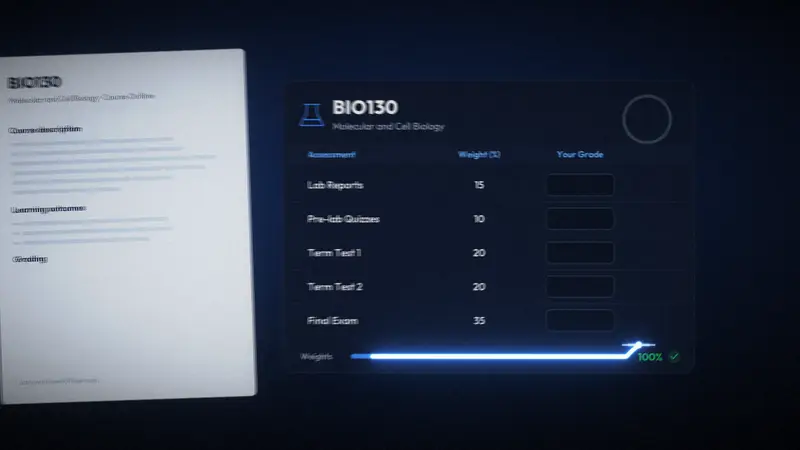</a>

A 23-second film made entirely in code: one camera flight and one line of light, timed to the voice-over. [Watch it with sound](docs/readme/promo.mp4). The renderer lives in [`promo/film`](promo/film).

<br>

## What's new in 2.0

| | Change | Details |
|:---:|---|---|
| 🗓️ | **Quercus deadlines** | Paste your Quercus calendar link once. Assignments, quizzes and tests from every course land in one list. |
| 🔀 | **Courses \| Deadlines** | A switch under the welcome heading shows your grades or your deadlines, one at a time. The tab badge counts what's overdue or due this week. |
| ➕ | **Add to grades** | Turn a deadline into a grade row on its course with one click, from the list or from the course page. |
| 🔥 | **Busy-week warnings** | A heads-up when one week holds two or more tests, or five or more items. |
| 🧭 | **Deadlines everywhere** | Each course card shows its next item, and each course page lists what's coming up on Quercus. |
| 🔔 | **Quieter notifications** | Confirmations and undo now appear inside the nav bar instead of over your work. |
| ✨ | **Cleaner screens** | A one-column profile that previews your name as you type, a simpler About page, and a calmer empty dashboard. |
| 🎓 | **Updated tutorial** | The first-run tour covers the new switch, never hides what it points at, and ends with a short send-off. |

<br>

## A tour

### Your dashboard

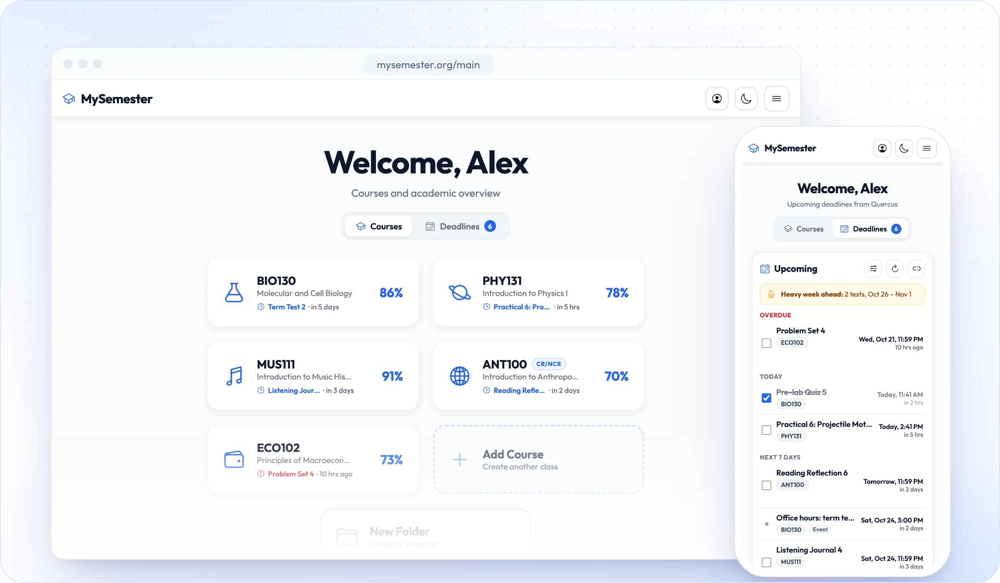

Every course is a card with its average, its letter grade and the next thing due on Quercus. Below the cards, your GPA, letter average and percent average update as you enter marks.

- **Folders** group courses by semester. Drag a course onto a folder to move it.
- **Right-click a card** (or long-press on a phone) to edit, duplicate, remove, or mark it CR/NCR.
- **Remove by mistake?** Undo sits in the nav bar for a few seconds.

### Quercus deadlines

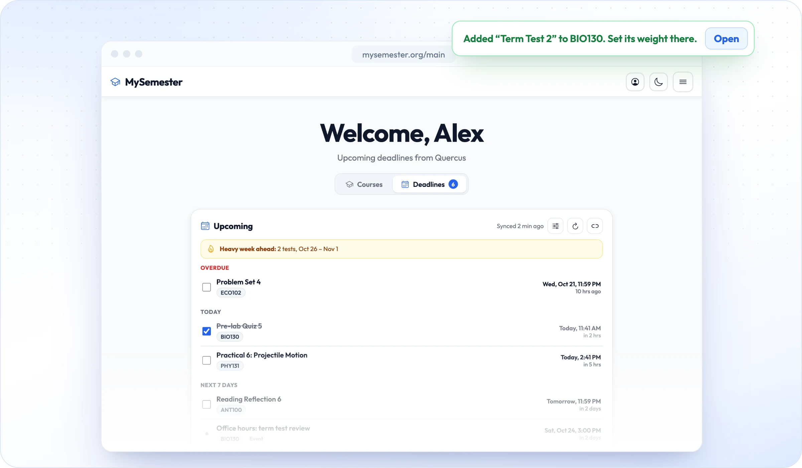

The Deadlines tab groups everything into **Overdue**, **Today**, **Next 7 days** and **Later**. Tick items off as you finish them, open any item in Quercus, or tap its course to jump to the grade page.

<picture>
  <source media="(prefers-color-scheme: dark)" srcset="docs/readme/flow-dark.svg">
  
</picture>

**How to connect**

1. Open **Quercus → Calendar**.
2. At the bottom of the right sidebar, click **Calendar Feed** and copy the link.
3. In MySemester, open **Deadlines → Connect Quercus** and paste it.

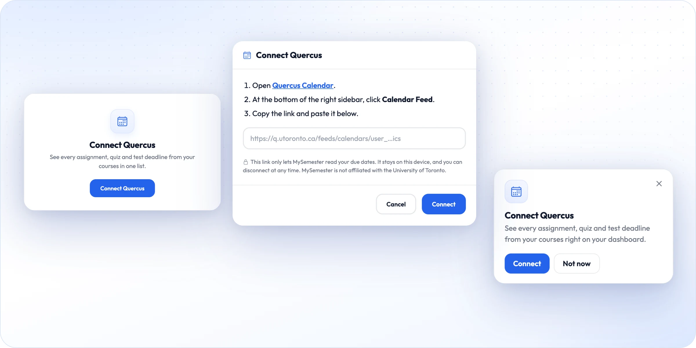

New UofT students see a small invitation slide into the corner of the dashboard. It goes away for good with **Not now**, and connecting is always one click away on the Deadlines tab or in the ☰ menu.

Once connected, the list refreshes when you open the dashboard (if it's more than 15 minutes old) or whenever you press ↻.

> [!CAUTION]
> Your Calendar Feed link works like a password for your Quercus calendar: anyone who has it can read your due dates. Don't share it, post it, or paste it anywhere except MySemester.

> [!IMPORTANT]
> Only items your instructors post to the Quercus calendar appear here. Many test dates live only in the syllabus or on Crowdmark and MarkUs, so keep checking each course outline. The feed also can't tell whether you've submitted something, so tick items off yourself.

> [!TIP]
> Quercus feeds include non-class calendars too, like library or orientation modules. Use the filter button in the Deadlines panel to hide them.

### Grades for every course

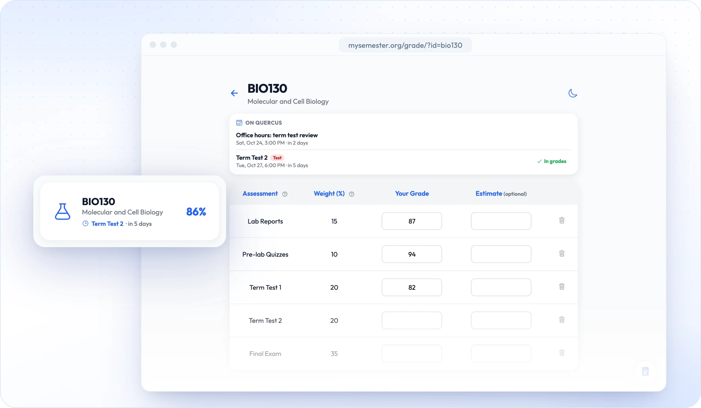

Open a course to see its assessment table: each row has a weight, your grade and an optional estimate. The average updates as you type, and **Estimate** shows what you need on the remaining work to reach your target (85% by default, changeable in Settings).

- **Import syllabus** reads the course outline PDF and fills in the grading breakdown. You check and edit it before anything is added, rules like "best 4 of 5" are shown as notes, and the file isn't kept.
- **On Quercus** lists the course's next items above the table. **Add** turns one into an unweighted row, ready for its weight.
- **The built-in calculator** (bottom right) helps when a grade arrives as a fraction.
- **Double-click** a name or weight to edit it in place.

### Planning tools for UofT

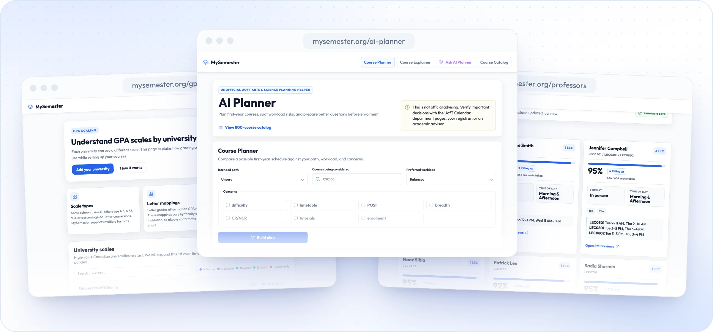

| Tool | What it does |
|---|---|
| **Course Planner** | Compare a possible schedule against your path and workload, get plain-language course explanations, run a semester check against your saved courses, and browse an 800-course catalog. |
| **Professor Picks** | Search a St. George course to see who's teaching each lecture section this year, from UofT Timetable Builder, ranked by ratings from MySemester students: stars, would-take-again, difficulty and top tags. Signed-in students rate the instructors they had, and each card links to Rate My Professors too. |
| **GPA Scale guide** | See how each supported university turns percentages into letters and grade points. |

> [!WARNING]
> The Course Planner and Professor Picks are unofficial helpers. Instructors can change before a term starts, so confirm sections in Timetable Builder or ACORN, and confirm program, prerequisite and graduation decisions with the Academic Calendar, your department or your registrar.

### Light, dark, and your phone

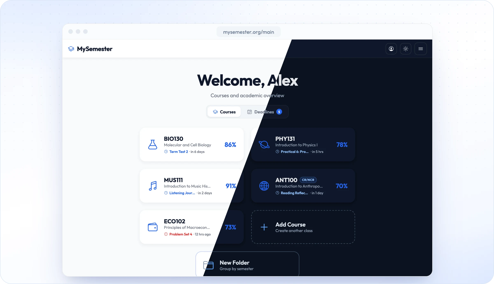

Choose light, dark or your system's setting, and a compact or spacious layout, from **Settings**. Every screen is built for phones as well.

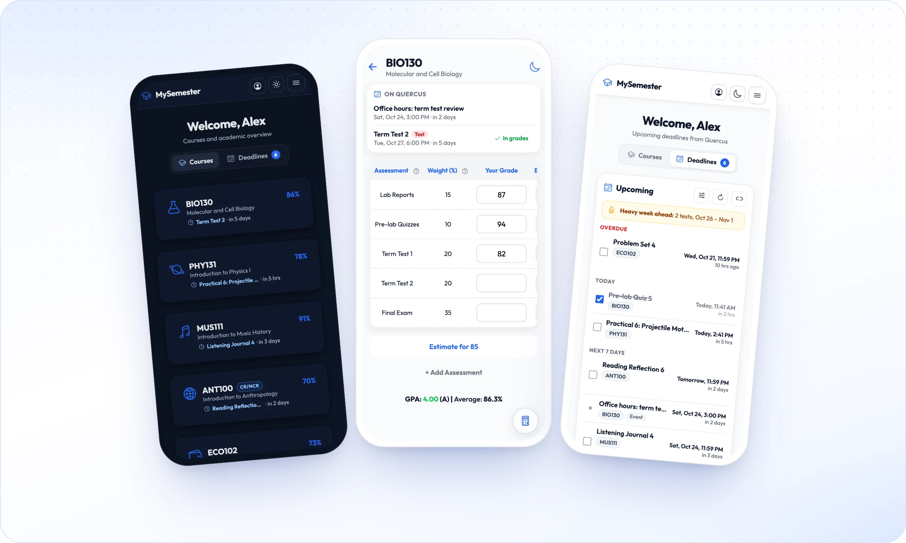

### Your profile and the first-run tour

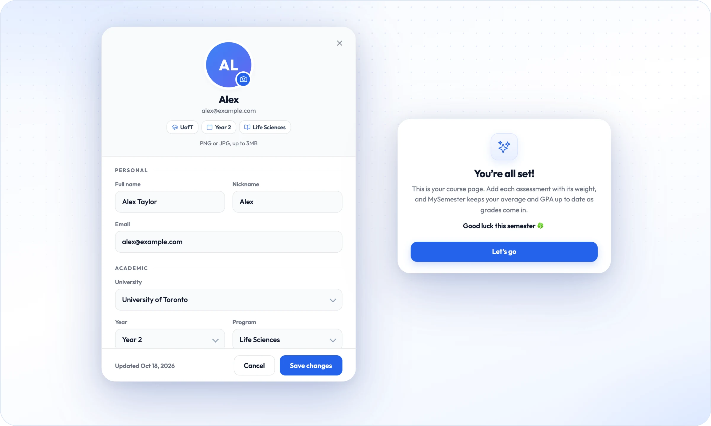

Your profile holds your name, nickname, email, photo, university, year and program. The header updates as you type, so you can see how you'll appear before saving. New accounts get a short guided tour that ends on your first course page.

<br>

## Where your data lives

| What | Kept in | Synced between devices |
|---|---|---|
| Courses, assessments, grades and folders | This browser, plus Supabase when you're signed in | ✅ When signed in |
| Profile, university, theme and settings | This browser | ❌ |
| Quercus link, deadlines, ticks and hidden courses | This browser | ❌ |

Signed-in sync merges by item and keeps the newest edit, so editing on two devices doesn't duplicate courses. Deleting a course on one device removes it from the others on their next sync.

> [!TIP]
> **Settings → Export** saves everything as a JSON file you can import later or on another device. **Bulk import** accepts CSV rows of `code,title,grade,icon,folder` (only `code` is required).

<br>

## Get started

You need **Node.js 20.9** or newer.

```sh
npm install
npm run dev
```

Open [localhost:3000](http://localhost:3000). Everything works without keys. Two optional settings go in `.env.local` (their names are in `.env.example`):

| Variable | Adds |
|---|---|
| `OPENAI_API_KEY` | OpenAI-written Course Planner answers, and AI help reading syllabi. Without it, the planner uses its built-in rule-based answers. |
| `NEXT_PUBLIC_SUPABASE_URL`, `NEXT_PUBLIC_SUPABASE_ANON_KEY` | Points sign-in and sync at your own Supabase project instead of production. |

> [!CAUTION]
> `OPENAI_API_KEY` is a server-side secret that can run up charges if it leaks. Keep it in `.env.local` or your host's environment settings, never in client code or a commit.

### Supabase (optional)

Sign-in and cloud sync need a Supabase project. Run the SQL below once, then everything in `supabase/migrations/` (it adds folder sync and course order, and is safe to re-run).

<details>
<summary><b>1. Username to email lookup</b></summary>

```sql
create or replace function public.get_email_by_username(u text)
returns text
language sql
security definer
as $$
  select email from public.profiles where username = u limit 1;
$$;

grant execute on function public.get_email_by_username(text) to anon;
```

</details>

<details>
<summary><b>2. Courses table and row-level security</b></summary>

```sql
create table if not exists public.mysemester_courses (
  id uuid primary key default gen_random_uuid(),
  user_id uuid not null,
  course_id text not null,
  code text not null,
  title text,
  icon text,
  grade numeric,
  crncr boolean default false,
  weights jsonb,
  updated_at timestamptz default now()
);

create unique index if not exists mysemester_courses_user_course_id_idx
  on public.mysemester_courses (user_id, course_id);

alter table public.mysemester_courses enable row level security;

create policy "Users can read their courses"
on public.mysemester_courses for select using (auth.uid() = user_id);

create policy "Users can insert their courses"
on public.mysemester_courses for insert with check (auth.uid() = user_id);

create policy "Users can update their courses"
on public.mysemester_courses for update using (auth.uid() = user_id);

create policy "Users can delete their courses"
on public.mysemester_courses for delete using (auth.uid() = user_id);
```

`course_id` holds the course's own id. Older rows used the course code, and the app adopts those on the first sync.

</details>

> [!WARNING]
> Granting `get_email_by_username` to `anon` lets anyone turn a username into an email address. Consider dropping username sign-in, or moving the lookup behind a server route.

<br>

## How it's built

| Layer | Technology |
|---|---|
| Framework | Next.js 16 (App Router), React 19, TypeScript |
| Styling | Plain CSS per route, with shared tokens for light and dark |
| Server | Route handlers for the Course Planner (`/api/ai-planner/*`), the Quercus feed (`/api/quercus/feed`) course timetables (`/api/timetable/[code]`) and syllabus import (`/api/syllabus`) |
| Accounts and sync | Supabase auth, with `mysemester_courses` and `mysemester_folders` tables |
| Tests | Vitest for grading, sync, import and export, the planner, and the calendar feed parser |

The Quercus route is deliberately narrow. It accepts only `https://q.utoronto.ca/feeds/calendars/…` links, never follows redirects, caps the response size, rate-limits each client, and doesn't store or log the link. The calendar itself is parsed by a small iCalendar reader in `lib/ics.ts`.

<details>
<summary><b>Project structure</b></summary>

```text
app/
├── page.tsx                  # Landing splash → /main/ or /login/
├── login/ signup/ reset-password/ setup/
├── main/                     # Dashboard
│   ├── Dashboard.tsx         #   courses, folders, Courses | Deadlines switch
│   ├── UpcomingPanel.tsx     #   deadline list, filters, busy-week banner, connect dialog
│   ├── QuercusPrompt.tsx     #   slide-in "Connect Quercus" invitation
│   ├── ProfileDialog.tsx  AboutDialog.tsx  SettingsDialog.tsx  Tour.tsx
│   └── upcoming.css  main.css
├── grade/                    # A course's assessments, estimates, calculator
│   ├── CourseDeadlines.tsx   #   "On Quercus" box
│   ├── SyllabusImport.tsx    #   upload a syllabus, review its grading breakdown
│   └── TourFinale.tsx        #   the tour's closing card
├── ai-planner/  professors/  gpa-scale/
└── api/
    ├── ai-planner/[route]/   # plan | explain | semester-check | ask
    ├── quercus/feed/         # fetches and parses a Quercus calendar feed
    ├── timetable/[code]/     # a course's sections and instructors, cached 6 hours
    └── syllabus/             # reads a syllabus PDF or text once, returns its grading scheme
components/                   # Icon, Dialog, Toast, MiniCalc, auth form bits
lib/
├── types.ts  semester.ts  use-semester.ts  cloud-sync.ts
├── grading.ts                # letters, GPA tables, averages, estimates
├── quercus.ts  ics.ts        # deadlines: feed parsing, grouping, course matching
├── timetable.ts              # Professor Picks: Timetable Builder sections and instructors
├── professor-ratings.ts      # Professor Picks: student ratings and ranking
├── syllabus.ts               # grading-scheme extraction from syllabus text
├── ai-planner.ts
└── *.test.ts
data/ai-planner-courses.json
supabase/migrations/
docs/readme/                  # README artwork and the scripts that make it
```

</details>

<br>

## Checks

```sh
npm test            # unit tests
npm run lint        # ESLint
npm run typecheck   # TypeScript
npm run build       # production build
```

## Deployment

The app needs a Node host for its API routes, so a static host like GitHub Pages won't work. On Vercel:

1. Import the repository and keep the default Next.js settings.
2. Add `OPENAI_API_KEY` under Environment Variables if you want OpenAI-written planner answers.
3. Add the custom domain (`mysemester.org`) and point its DNS at Vercel.
4. In **Supabase → Authentication → URL Configuration**, allow the site URL and `https://<domain>/reset-password/` as redirect URLs.

Page URLs are the same as the original static site (`/main/`, `/grade/`, `/login/` and so on), and existing saved data loads as-is.

## README artwork

The images in `docs/readme/` are made by two scripts. The demo student and courses are made up.

```sh
node docs/readme/generate.mjs   # logo, animated hero and flow diagrams (SVG)
npm run dev                     # then, in a second terminal:
node docs/readme/capture.mjs    # framed screenshots (needs Google Chrome and cwebp)
```

## What's next

- **Grades straight from Quercus.** With a personal access token, courses, assessment weights, released marks and submission status could fill in on their own.
- **"What you need on this test."** Pair the upcoming test with your target, for example *Term Test 2 is Tuesday; you need 74% to keep an A-.*
- **Read the syllabus.** Upload a course outline to fill in missing weights and test dates.
- **Your own deadlines,** for dates that never reach the Quercus calendar, with ticks that sync between devices.
- **A calendar view** of the Deadlines tab.

<br>

> [!IMPORTANT]
> MySemester is an independent student project. It is not affiliated with or endorsed by the University of Toronto or Instructure (the makers of Canvas, which Quercus runs on).

<br>

<div align="center">

<sub>Made for students · [mysemester.org](https://mysemester.org) · © 2026 Jamie Ryu · All rights reserved</sub>

</div>
